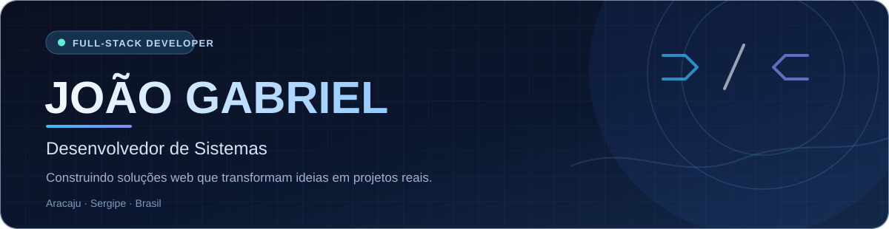

# João Gabriel dos Santos Gois

**Desenvolvimento web full-stack · Interfaces, APIs e soluções para problemas reais**

Aracaju, Sergipe · Formação em Desenvolvimento de Sistemas pelo SENAI

[Sobre mim](#sobre-mim) &nbsp; · &nbsp; [Projetos](#projetos-em-destaque) &nbsp; · &nbsp; [Tecnologias](#tecnologias-e-ferramentas) &nbsp; · &nbsp; [Contato](#vamos-conversar)

---

## Sobre mim

Sou **João Gabriel**, formado em **Desenvolvimento de Sistemas pelo SENAI**. Desenvolvo aplicações web e aprofundo meus conhecimentos construindo projetos que conectam interfaces, regras de negócio e dados.

Gosto de entender a necessidade de quem vai usar o produto e participar de todo o caminho: da organização da interface à implementação da API e à publicação.

- **Foco:** desenvolvimento full-stack com JavaScript, React e Node.js.
- **Na prática:** sistemas de gestão e sites para apresentar negócios e facilitar o contato com clientes.
- **Em evolução:** arquitetura, testes, segurança e qualidade de código.
- **Interesse:** oportunidades de desenvolvimento, colaboração e projetos com aplicação real.

## Projetos em destaque

### 01 · API-Predial
**Gestão de manutenção predial · Aplicação full-stack**

Projeto Integrador do SENAI voltado à organização de solicitações de manutenção, com fluxos para moradores, operários e administradores.

- Abertura de demandas com fotos e acompanhamento do atendimento.
- Distribuição de tarefas, atualização de andamento e registro de impedimentos.
- Histórico, notificações, comunicação nos chamados e relatórios.
- Controle de acesso e separação de responsabilidades por perfil.

**Tecnologias:** React · Vite · Node.js · Express · MySQL · Prisma · Cloudinary

---

### 02 · Luana Carla Doceria
**Presença digital para um negócio local · Site em React**

Site de apresentação de uma doceria com mais de quatro anos de atuação. O projeto reúne fotos reais, informações sobre os produtos e um caminho direto para solicitar encomendas pelo WhatsApp.

- Galeria com filtros para bolos decorados, bolos com frutas e brigadeiros.
- Cardápio em PDF e seção de dúvidas frequentes.
- Formulário que prepara uma mensagem com os detalhes da encomenda.
- Layout responsivo e imagens otimizadas em WebP.
- Publicação no Cloudflare Pages, com código versionado no GitHub.

**Tecnologias:** React · Vite · JavaScript · CSS · Cloudflare Pages

> Uma solução estática, sem banco de dados: a escolha técnica acompanha a necessidade do negócio, e a encomenda é combinada diretamente com a doceria.

## Tecnologias e ferramentas

Conhecimentos que aplico e continuo desenvolvendo nos meus projetos.

| Área | Tecnologias |
| :--- | :--- |
| **Linguagens** | JavaScript · C# · HTML · CSS |
| **Frontend** | React · Vite · Tailwind CSS |
| **Backend** | Node.js · Express |
| **Dados** | MySQL · Prisma |
| **Versionamento e publicação** | Git · GitHub · Cloudflare Pages · Vercel · Render |

## Como trabalho e aprendo

**Entender o problema → Planejar → Desenvolver → Validar → Melhorar**

Procuro construir interfaces claras, organizar o código e escolher ferramentas de acordo com o projeto. Cada entrega também é uma oportunidade de revisar decisões, receber feedback e aprofundar meus conhecimentos.

## Vamos conversar?

Quer conhecer meus projetos, trocar experiências ou conversar sobre uma oportunidade?

- **LinkedIn:** [Gabriel Gois](https://www.linkedin.com/in/gabriel-gois-477207445/)
- **Instagram:** [@gabriellgois13](https://www.instagram.com/gabriellgois13/)
- **E-mail:** [jgabrielgois@outlook.com](mailto:jgabrielgois@outlook.com)
- **GitHub:** [@joaogabrielgois](https://github.com/joaogabrielgois)

---

<strong>João Gabriel dos Santos Gois</strong> · Desenvolvedor de Sistemas Aprendizado contínuo, projetos reais e atenção a quem usa.

